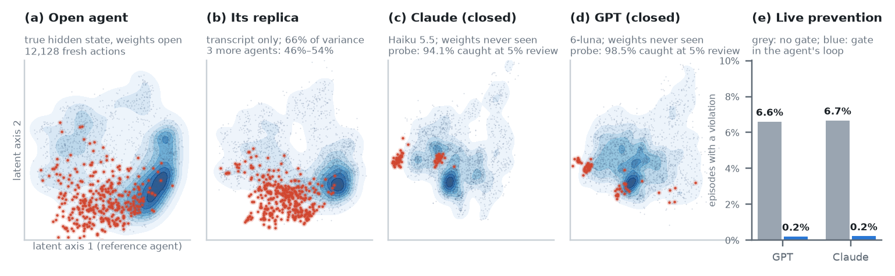

# Grey Box

[](https://github.com/AryaFayyazi/GreyBox/actions/workflows/ci.yml)

**Replicating the hidden state of closed agents from their transcripts, to predict and prevent violations.**



An agent's internal state is a function of the tokens that it read. So an open model that reads the same tokens can
hold a replica of part of it. From the transcript alone, the replica reconstructs 66% of the variance of the 128 main
components of an agent's hidden state (51–54% of each full layer; text features: 59%), and readouts trained on the
true state work on the replica (T15). Readouts also work on a replica from text features, because the information that
decides a violation is in the tokens. The same reader replicates three more open agents (46–54%, T17). We use the
reader to predict and block policy violations of closed agents (run with reasoning off) before they run.

Grey Box monitors AI agents that you cannot open. It decides if an agent's next action must go to a human
**before the action runs**. It reads only the data that every deployment can see: the agent's instructions, the
user's task, the earlier tool results and the proposed action. It does not need the model's weights, so it works on
closed models.

**Website: https://aryafayyazi.github.io/GreyBox/**
- Train a monitor on your own labelled agent steps, in your browser. The browser does not upload your data.
- See a monitor on a closed frontier agent (Claude Haiku 5.5), action by action, in 3D.
- Read every preregistered result, with the failures.

## Quick start

```
pip install "graybox[server] @ git+https://github.com/AryaFayyazi/GreyBox"
```

| Monitor | Hardware and speed | Use it when |
|---|---|---|
| `TextMonitor` (TF-IDF and logistic regression) | CPU, about 0.2 ms for each action | your tools and policies are the same as in your labelled data |
| `ReaderMonitor` (Qwen3-8B reads the transcript; a linear probe) | 1 GPU, 41 ms for each action | your tasks change; it is more robust to new tasks |

```python
from graybox.guard import Guard
from graybox.monitor import TextMonitor

guard = Guard(TextMonitor.load_json("greybox-text-monitor.json"))   # trained in the browser trainer
for call in reply.tool_calls or []:                                   # OpenAI; check_anthropic for tool_use blocks
    v = guard.check_openai(messages, call)
    result = run_tool(call) if v.allow else v.block_message
```

Train the stronger reader monitor on your own labels with one command on a GPU:
`python -m graybox.train_reader labelled.jsonl --out my_reader_probe.joblib`.

The browser trainer imports OpenAI and Anthropic agent logs, lets you label actions (a review queue shows the riskiest
first), and trains the monitor. Its importer and the guard build the same steps as our research pipeline (979/979 GPT
and 373/373 Claude units identical; `results/tool/`).

The reader's probes are in [release v0.2.0](https://github.com/AryaFayyazi/GreyBox/releases/tag/v0.2.0):
`reader_probe.joblib` (CAPE-Bench) and `reader_probe_cape_agentdojo.joblib` (CAPE-Bench and prompt injection).

For the reader, use `QuantileGate` to set the review threshold. It takes the top 5% of the agent's first 500
actions, then it freezes the threshold. Do not use the raw probability: it does not transfer between agents.

Self-host the HTTP API: `uvicorn graybox.monitor_server:app` (see `deploy/` for Docker). Your transcripts stay on your
machine.

## Main result

**Theory** (`docs/theory.md`, section T6). An agent's internal state is a function of the tokens that the agent read.
For an action-level label ("does this proposed action break the policy, given the facts that the agent saw?"), a
monitor that reads the transcript and the proposed action is Bayes-sufficient. No monitor that reads the agent's
internals at or before the action can do better. The remaining problem is statistical: learn the policy from
labelled examples.

**Evidence.** All tests below are preregistered and hash-locked. `docs/PREREGISTRATION_RECORD.md` gives each lock and
each outcome, with the failures and the deviations. AUROC 0.5 is chance; 1.0 is perfect.

| Test | Result |
|---|---|
| T2: timing | A probe on the agent's internals scores 0.979 after the agent's reasoning, and 0.841 at the start of the turn. The time of reading explains the white-box advantage. |
| T3: labels | Without labels, a 70B judge that scores resampled actions gets 0.782. The probe on the internals gets 0.976. |
| T4, T5: a transcript reader with labels | 0.994 on the same scenarios (the agent's internals: 0.979). 0.969 on unseen task families (internals: 0.976). |
| T6: another open agent | Trained on Gemma, applied to gpt-oss: 0.915 (zero-shot judge: 0.833). |
| T7: an external benchmark | AgentDojo prompt injection, no AgentDojo training: 0.78 (judge: 0.54). On gpt-oss it beats CAPE's white-box gate (0.82 vs 0.60). |
| T8b: a closed frontier agent | Claude Haiku 5.5, 3,128 actions. Trained only on Gemma, the reader catches 94.1% of the 68 violations when the top 5% of actions go to review, with a cut set without labels (95.6% with a cut set on labelled safe actions). The judge catches 0%. Claude ran with thinking off. Pooled AUROC 0.989 (judge 0.570; exploratory). The preregistered within-template AUROC (0.991 vs 0.633) uses only one stratum: 136 actions, 26 violations. |
| T9: reader or labels? | A TF-IDF monitor with the same labels is equal to the reader on the training benchmark (Claude 0.997 vs 0.991). On unseen task families the reader is better (0.969 vs 0.950). On AgentDojo, TF-IDF is at chance (0.50 vs 0.78). |
| T10: a policy that the monitor never saw | The reader still ranks the violations well (pooled 0.912; judge 0.570). But at a 5% budget it escalates 0 of 26 violations. With 20 to 40 labelled examples of that policy, it catches 85% to 94% (exploratory). |
| T11: a second closed family (GPT) | GPT-6-luna, 3,627 actions, 66 violations in 6 families. Pooled AUROC 0.996 (judge 0.778; tool identity alone 0.856). Within tool 0.994 (judge 0.956). At a 5% budget it catches 98.5% (judge 37.9%). All three preregistered endpoints pass. |
| T12: labels for a new policy, prospective | We held out a credentials policy. With no labels of it, the reader caught all 18 of GPT's violations of it. The preregistered H1 (labels improve the catch rate) fails: there was nothing to fix. A new policy that resembles a trained one can transfer; one that does not (T10) needs labels. |
| T13, T13b: a closed agent on an external benchmark | GPT-6-luna on AgentDojo. With the spotlighting defense, attacks succeed in 2.1% of episodes (4 injected calls): not tested. Without the defense, 36 injected calls: reader 0.840 vs judge 0.787 (+0.052 [−0.026, +0.130]). The preregistered test fails: on an external benchmark the reader is not significantly better than a zero-shot judge for this closed agent. |
| T14: labels of the new policy, from open agents | We added labelled AgentDojo calls of the two open agents to the training data, and tested on the closed GPT agent. AUROC 0.840 → 0.922 (judge 0.787); injected calls caught at the label-free 5% cut 28% → 58% (36% → 92% with a cut set on benign calls). Both preregistered endpoints pass. Exploratory: on the confirmation split only, whose user tasks the training calls never saw, 0.929 vs judge 0.786 (+0.143 [0.075, 0.226]). On this benchmark, labels of a policy transferred from open agents to a closed one. |
| T15: does the grey box replicate the hidden state? | From the transcript alone, the reader replica reconstructs 66.4% of the variance of the agent's decision state (text: 58.6%). A probe trained on the true state scores 0.987 on the replica vs 0.984 on the true state. |
| T17: replication on three more open agents | gpt-oss-20b (mixture of experts), Qwen3.8-27B (hybrid linear attention), Muse-Glimmer-30B (dense), on scenarios that the map never saw. The same reader replicates each agent's decision state better than text features: R² 0.49, 0.54, 0.46 (text 0.39, 0.44, 0.40). A probe trained on the true states works on every replica (0.900 → 0.924, 0.955 → 0.972, 0.929 → 0.969). All six endpoints pass. Replication is partial (about half of the variance), and the readout also works on a text replica. |
| T16: live prevention on a closed agent | The monitor in GPT-6-luna's loop (500 scenarios, with and without the gate). Episodes with an executed violation: 6.6% → 0.2% (−0.064 [−0.088, −0.044]). No violation after a block. Goals reached 47.4% → 45.6%. Round trip 89 ms. |
| T16b: live prevention on Claude | The same live test on Claude Haiku 5.5 (450 scenarios). Episodes with an executed violation: 6.7% → 0.2% (−0.064 [−0.087, −0.044]). No violation after a block. Goals reached 40.7% → 34.9%. Round trip 80 ms. |
| T16c: hold for review instead of block | On Claude (450 scenarios), escalated actions go to a reviewer (here an oracle; an upper bound on a human). Episodes with an executed violation: 6.7% → 0.0% (R1 passes). Goals 38.7% (no gate 40.7%, blocking 34.9%); the preregistered "at most 3 points lost" fails (−0.020 [−0.051, +0.007]). Exploratory: episodes in which the reviewer let a held action run kept their goals (60.8% vs 58.8%); the gap is in episodes where nothing was held, which we suggest is variation between runs (untested: the control was not concurrent). 0.20 reviews per episode. |
| Review threshold without labels (exploratory) | A threshold from the agent's own unlabelled traffic, frozen after 500 actions: 95.4% caught online, 1.9% of safe actions escalated. With a burst of violations, it stays at 94%; a rolling threshold falls to 36%. |

**Results that did not confirm** are in the record too. Examples: the agent's answers alone do not match the
white-box probe (T1, F3), and resampling scored by an LLM judge loses to the probe (T3).

## Limits

- Most agent tests use one benchmark, CAPE-Bench. On the external test (AgentDojo), the reader beats a zero-shot judge
  for open agents (0.78 vs 0.54), but not significantly for a closed agent (0.840 vs 0.787, T13b).
- On τ²-bench (T18, 600 Claude Haiku 5.5 episodes), Claude broke the airline policy in only 9 writes from 3 tasks. That is
  below the preregistered minimum of 15, so the test was not done. Descriptively, word counts trained on other agents'
  labels did better there than the reader (within-tool AUROC 0.963 vs 0.756).
- A monitor can miss a policy that is not like the policies in its training data (T10). Label a few dozen steps of
  each such policy. A policy that is like a trained one can transfer without labels (T12).
- The sufficiency corollary (Corollary 1 in the paper; Corollary 3 in `docs/theory.md`) applies to action-level labels. It does not apply to labels about later behaviour or about beliefs.
- Chat readouts recover the behaviour of a model, not its hidden beliefs.

## Chat: forecast a refusal before the reply

A *grey box* is the model's **interrogation state** Ψ(x): the probabilities of the answer "Yes" to a fixed list of
questions. We ask the questions in side branches of the conversation, so the real reply never sees them.
- Ψ recovers the hidden state of models with known internals: a program compiled into a transformer (21/21 states with a battery designed for it; 16/21 with a random one),
  Othello-GPT (R² 0.967) and 8 open chat models. L1 and L2 are preregistered; L0 is a development test.
- Readouts trained only on open models transfer to Claude: harmful request 0.993, refusal 0.997 AUROC (L3).
- As a refusal forecast on Claude, Ψ only ties a graded moderator (L3e: 0.87 vs 0.85, not significant). With a
  moderator, it doubles the precision of an alarm for harmful requests that the model answers (0.54 vs 0.27).
- It is not a content filter: a text moderator is better at the decision "is this message harmful?" (0.97 vs
  0.85–0.93).

**Grey Box Live in the browser** (`web/live_browser.html`) chats with Claude Haiku 5.5. It shows Claude's path in a
3D space shared with open models, the forecast "Claude will refuse", and the alarm "a moderator says Unsafe and
Claude will not refuse". Each message uses 4 Claude calls on the viewer's own account.

## Reproduce

| Path | Content |
|---|---|
| `src/graybox/` | the SDK: monitors, gate, batteries, adapters, servers, spend ledger |
| `scripts/` | the experiments, in order; each script's docstring gives its command |
| `docs/PREREGISTRATION_RECORD.md` | every confirmatory test, its lock and its outcome |
| `docs/theory.md` | the propositions and their proofs |
| `docs/research_ledger.md` | a dated log of each experiment, decision, failure and fix |
| `paper/main.tex` | the paper (ICML format); `paper/make_numbers.py` and `paper/make_record.py` write its result macros and its record appendix from the files below |
| `docs/paper_draft.md` | an early draft, kept for the record (superseded by `paper/main.tex`) |
| `results/` | the saved output of each analysis (summary statistics; the per-action data and GPU features are not public) |
| `site/` | the website builder and the browser-vs-Python parity tests |

Checks:
- `python scripts/99_verify_all.py` verifies each lock hash, re-derives each pass/fail from its saved interval, and
  prints the headline numbers. About 20 locked files (frozen models and per-action scores under `/data/models`) are
  not public, so from a clone it reports them as missing; the repository files all verify.
- `python scripts/98_audit_numbers.py paper/main.tex README.md` checks that each decimal in a document occurs somewhere
  in the saved results. This is a weak check (most short decimals occur somewhere); the paper's main result numbers
  are written from named result fields by `paper/make_numbers.py`.
- `pytest tests` runs the SDK tests (also in CI).

What you can reproduce from this repository alone: the SDK and its tests, the browser–Python parity tests, the lock
hashes of the repository files, and every summary number from `results/`. The experiments themselves need data that
is not public (agent episodes, hidden states, reader features, CAPE-Bench internals), GPUs, and paid API calls.

Lock times are self-reported in each lock file. For T13b, T16 and T20 the lock was also published (git) before the
result; from T20 on, every lock is pushed before its test runs.

The experiments ran on a Slurm cluster, one GPU at a time (`slurm/run.sh`). Paid API runs share a file-locked spend
ledger with a hard cap.
