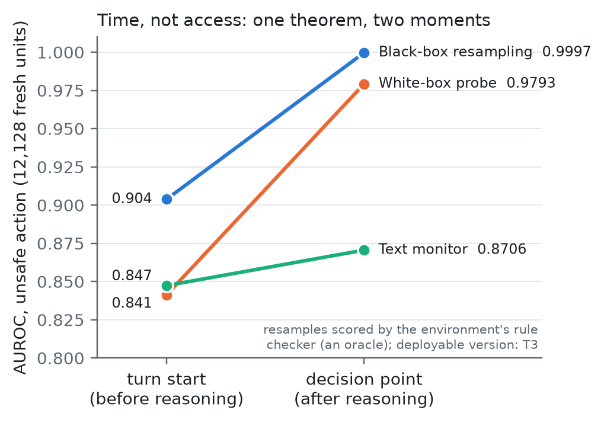
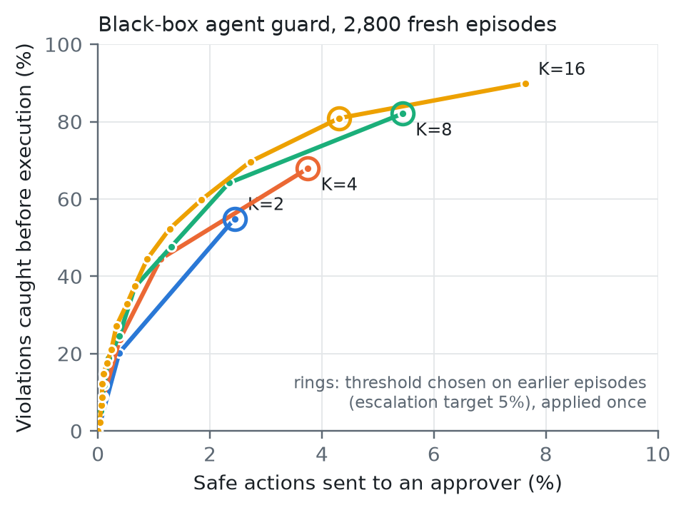
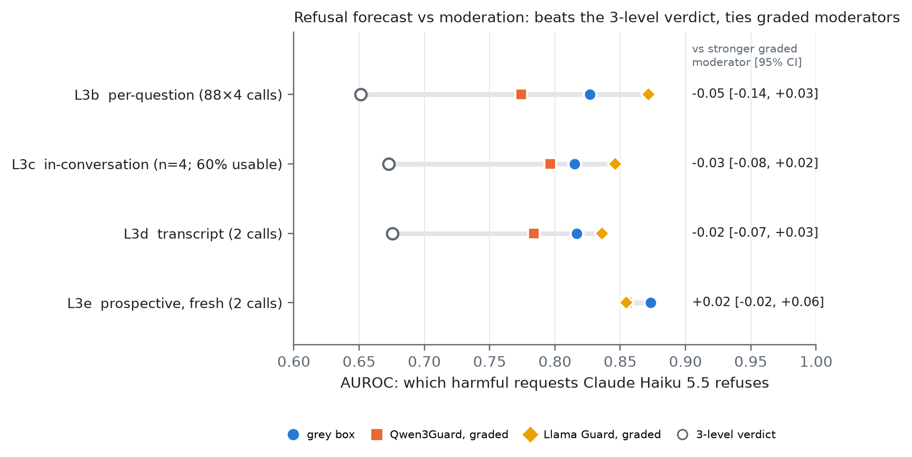
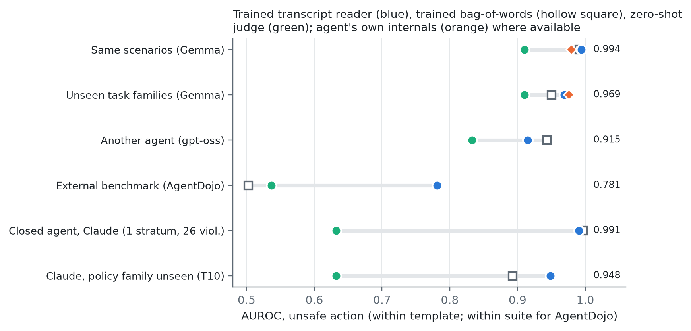
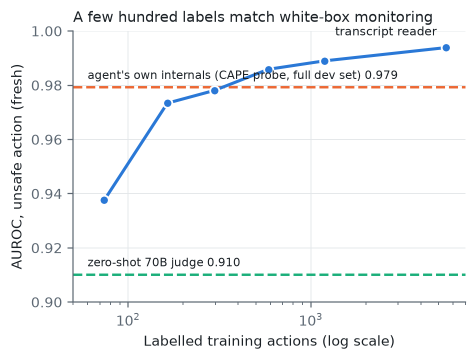

# Labels, Not Access: What a Black Box Reveals About Its Hidden State, and How to Monitor Closed Agents

*Draft. Numbers marked ⟨…⟩ are pending. Every confirmatory number comes from a preregistered, hash-locked test.*

## Abstract

Safety monitors that read a model's internals need its weights, but the most capable agents expose only text. We show
that, for the labels agent monitoring is about (would this proposed action violate the policy, given what the agent
has seen?), weight access adds nothing that a monitor cannot get from the transcript and the proposed action:
- An agent's internals are a function of the tokens it has read. Their only possible advantage is tokens the
  transcript hides.
- For action-level labels, the proposed action makes even those irrelevant.
- What remains is statistics: learning the policy from labelled examples.

A series of preregistered, hash-locked tests checks each part:
- **Timing, not access.** Reading after the agent's reasoning explains why white-box probes beat turn-start monitors
  (0.979 vs 0.841 AUROC).
- **Labels.** Without them, a 70B judge scoring resampled actions loses to a probe (0.782). With them, an open reader
  of the transcript and proposed action beats the agent's own internals (0.994 vs 0.979).
- **Closed agents.** Trained only on an open agent, the reader catches 96% of a closed frontier agent's violations
  (Claude Haiku 5.5) at a 5% review budget, where a zero-shot judge catches 0%.
- **The limits are statistical too.**
  - A bag-of-words monitor trained on the same labels matches the reader in distribution, but falls to chance on a
    new benchmark (0.50 vs 0.78).
  - For a policy family absent from training, the reader still ranks violations well (0.912), but escalates none until
    20–40 labelled examples are added.
- **Deployment without labels from the new agent.** A review threshold set from the agent's own unlabelled traffic,
  then frozen, catches 95% of violations online, and stays robust to bursts of violations that defeat a rolling one.

On chat models, answers to side-branch questions recover the behavioural state of models with known internals and
transfer to Claude. As a refusal forecast, though, they only tie a graded moderator.

We release the full preregistration record (failures included), an SDK, and a website where anyone can train and
audit a monitor on their own agent in the browser.

## 1. Introduction

- Interpretability-based safety monitors read activations. They need open weights.
- The models with the most capability, and the most risk, are closed. Their providers expose sampled text, sometimes
  top-k log probabilities, and summarized reasoning.
- Earlier work recovers the final unembedding layer from logits (Carlini et al., 2024; Finlayson et al., 2024). Others
  ask models follow-up questions to detect lies (Pacchiardi et al., 2023; Sam et al., 2025). A recent head-to-head
  finds such batteries match activation probes on prompted lies and fail on belief-verified model organisms
  (Cooney et al., 2026). Open "reader" models can probe closed transcripts (Model Hermeneutics, 2026).
- Two questions remain open:
  1. What do outputs determine about the hidden state, exactly?
  2. When does black-box access lose nothing for safety?
- **Contributions.**
  1. *Identifiability.* Hidden coordinates are unidentifiable (gauge). The behavioural state is identifiable: exactly
     for finite-state models, up to the depth of the battery (Myhill–Nerode).
  2. *Sufficiency.* For labels defined by the model's own behaviour, the rollout forecast dominates every probe on
     hidden states, under every proper scoring rule and in ROC. A label decided by the next token needs one logprob
     query. Outcome-selected evaluation units break this guarantee and can make supervised monitors look better than
     the Bayes forecast.
  3. *A ground-truth ladder.* Compiled programs, a world model, 16 random worlds, open chat models, open agents.
     Each rung has known internals and a preregistered test.
  4. *Time, not access; and the label function decides in practice.*
     - With an oracle label function, resampling dominates state readouts at every moment (T1, T2, preregistered).
     - CAPE's probe advantage over turn-start monitors is a timing advantage.
     - With a deployable judge, white-box probes win (T3): probes amortize the label function, resampling must
       evaluate it at test time.
  5. *Closed models, chat.* Readouts trained only on open models transfer to Claude. For refusals they tie strong
     graded moderation and add to it in combination (L3, L3b, L3d, L3e).
  6. *A tool.*
     - An API, an SDK and an in-browser viewer that place any API model, open or closed, in a shared space.
     - Readouts carry their held-out accuracy.
     - A one-call transcript format costs about $0.001 per turn on a closed model. The in-conversation questionnaire
       it replaces is rejected by Claude as a prompt injection.
- **What we do not claim.** The target-specific part of the signal is small. A strong open reader answering the same
  questions about a transcript does nearly as well as the target itself (§4.2, §4.3). The value of reading the target
  is calibration to its own behaviour and access where no reader exists.

## 2. Setup and theory

**Notation.**
- B is the model, x a context, and τ the future it generates.
- Y = g(τ) ∈ {0, 1} is a label defined by that future.
- φ(x) is any internal representation of x.
- π*(x) = P(Y = 1 | x) is the behavioural forecast.
- A battery Q = (q₁, …, q_m) is a list of questions with yes/no answers.
- The interrogation state is Ψ_Q(x) = (P_B(yes | x ⊕ q_j))_j, where x ⊕ q_j appends question q_j to the user's
  latest message.
- θ_j = 2 arcsin √Ψ_j are its Fisher–Rao coordinates.

**Proposition 1 (gauge).** For any invertible G, the model with hidden space rotated by G computes the same function.
So no black-box method can recover hidden coordinates, and a probe fitted in one basis does not transfer to another.
Ψ is unchanged.

**Proposition 2 (identifiability for finite-state models).** If the behaviour is generated by a finite automaton with
minimal automaton M, then Ψ over all suffixes identifies the state of M exactly, and nothing more. A finite battery
identifies it iff it contains a distinguishing suffix for every pair of states.

**Proposition 3 (behavioural sufficiency).** Suppose φ(x) carries no information about future sampling noise given x.
Then π*(x) has maximal ROC and minimal risk under every strictly proper scoring rule among all forecasts f(φ(x)). With
K rollouts the AUROC loss is at most E[exp(−KΔ²/2)] over positive–negative pairs with gap Δ.

**Corollary (one-step labels).** If Y depends only on the next token, π*(x) is a sum of next-token probabilities: one
logprob query.

**Proposition 4 (selection).** If evaluation units are included based on events after x, a supervised monitor can
exceed AUROC(π*) on them by learning the selection rule.

**Proposition 5 (access is not information).** An agent's internal state at step t is a deterministic function of the
tokens Z_t it has read and written. So for any label, internals add nothing to the full token history. The best
white-box monitor beats the best transcript monitor only through tokens the transcript hides (H_t, e.g. private
reasoning), and under log loss by exactly I(Y; H_t | V_t), where V_t is the visible transcript.

**Corollary (the proposed action is sufficient).** Suppose the label is a policy check on the proposed action given
the visible facts, Y = g(A_t, V_t, W), and facts W the agent has not observed are independent of its tokens given
V_t. Then a monitor that reads the transcript and the proposed action is Bayes-sufficient: no white-box monitor at or
before the decision point can beat it. A probe read before the action is emitted must also predict which action will
be sampled, so it can do strictly worse.

**What remains is statistics.** The excess risk of a trained transcript monitor is the risk of learning
P(Y | V_t, A_t). It depends on the label function (T3), the representation (T9), and the coverage of the policies
in the labelled data (T10). Sections 4.2–4.6 test each term.

*Proofs: Appendix A.*

## 3. A ground-truth ladder

### 3.1 A program compiled into a transformer
- We compile a causal two-bracket Dyck checker into a 7-layer transformer with tracr. Its hidden state is known
  exactly: the running balances.
- The compiled model matches the program on all tested sequences.
- A battery of 21 questions, chosen from black-box answers only by greedy splitting, separates all 21 behavioural
  states. Random short suffixes merge states that need deeper questions, as Proposition 2 predicts.
- Rotating the residual stream by a random orthogonal matrix leaves every output identical. A readout that uses the
  known layout drops from r = 0.9995 to r = −0.46. The grey box is unchanged.

### 3.2 A world model: Othello-GPT
- Othello-GPT predicts legal moves. Its board state is linearly decodable from its residual stream (Li et al., 2023;
  Nanda, 2023).
- Our battery is the next-move distribution, plus the next-move distribution after each of the 60 one-move suffixes:
  61 queries.
- **Preregistered test on 1,000 fresh games** (decoders frozen on development games):
  | Endpoint | Grey box | Input-only | Difference |
  |---|---|---|---|
  | Hidden-state R² (top-64 PCs of layer 6) | 0.967 [0.967, 0.968] | 0.873 | +0.094 [0.086, 0.105] |
  | Occupied-stone accuracy | 0.797 | 0.754 | +0.043 [0.040, 0.046] |
  - Both differences: Holm p < 0.0005. White-box probe reference: 0.983.
- Depth matters. In the subspace that carries the board, R² rises from 0.65 with one-move questions to 0.72 with
  two-move questions. Broad fixed questions beat sampling the model's own continuations at the same budget.

### 3.3 Sixteen random worlds
- Each world is a random probabilistic automaton with 6–12 states. Each symbol permutes the states.
- A small transformer is trained on each world.
- A 21-question battery separates every state in 16/16 worlds.
- The black box decodes the latent state at white-box parity: 0.636 vs 0.635, Wilcoxon p = 0.84. It beats input-only
  features by 0.064 (p = 0.003).

### 3.4 Open chat models (preregistered)
- Eight open chat models from seven families answer 88 yes/no questions about 4,800 user messages. We compare their
  answers with their own residual streams at the token where they begin to reply.
- **Preregistered test on 1,440 held-out messages** (decoders frozen on development messages):
  | Endpoint | Estimate [95% CI] | Models |
  |---|---|---|
  | H1: the answers recover the hidden state better than a text embedding of the message (R² of the top-64 PCs) | +0.120 [0.115, 0.126] | 8/8 |
  | H2: a model's own answers reproduce its own internal sentiment-probe reading better than another model's answers (same query budget) | +0.057 [0.045, 0.073] | 7/8 |
  | H3: the answers reproduce that probe reading better than text | +0.359 [0.310, 0.415] | — |
  - All Holm p < 0.0005.
  - One deviation: standardized features are clipped at prediction, as in the development analysis. Before the
    clip, two estimates were numerically invalid. Appendix: preregistration record.
- **Per model:** the probe reading is recovered at R² 0.87–0.92 from the model's own answers (gpt-oss: 0.69). From
  the text it is recovered at 0.45–0.54.
- **What is not model-specific:** most of the variance of a hidden state encodes the message's content. Other
  models' answers recover it as well as the model's own. The model-specific part is the part its own probes read.
- **Neurons:** from 88 answers, 16–70% of the most active mid-layer MLP neurons are predicted at R² > 0.8. From text,
  2–21%.

### 3.5 How many questions, and which?
- From a fixed pool of 512 template questions, recovery grows smoothly with the number of questions, with no plateau
  by 512 (Qwen3, Llama-3.1, Mistral: hidden-state R² 0.20–0.32 with 8 random questions, 0.75–0.84 with 512).
- A black-box design (column-pivoted QR on the answer matrix, with no hidden states and no labels) nearly doubles
  recovery at small budgets: 0.39–0.43 with 8 designed questions.
- Designs transfer across families: a battery chosen on other models keeps most of the gain (0.31–0.40 at 8
  questions). This matters for closed models, whose battery must be designed elsewhere.

## 4. Safety

### 4.1 No probe beats rollouts (controlled)
- On Othello-GPT, the label is "the model plays a corner in its next H self-play moves".
  | H | Rollouts, K = 64 | White-box probe | Ψ |
  |---|---|---|---|
  | 1 | 0.872 (one logprob query: 0.877) | 0.744 | 0.772 |
  | 3 | 0.823 | 0.735 | 0.737 |
  | 6 | 0.796 | 0.730 | 0.714 |
- Rollout AUROC rises monotonically with K.
- A trained probe is worth about five to six rollouts.

### 4.2 Agents (preregistered on fresh episodes)
- CAPE-Bench agents (Fayyazi et al., 2026). Units are taken at the start of the agent's turn, the one point every API
  exposes.
- On outcome-selected units, a supervised text monitor beats the rollout forecast (0.919 vs 0.904). On units selected
  by the past only, the order reverses, as Proposition 4 predicts.
- **Development, clean units (5,493 turns):** 16 rollouts, with no training, forecast the violation at AUROC 0.909.
  A trained probe on the agent's own hidden state scores 0.837 (difference +0.072 [0.048, 0.096]). The grey box scores
  0.859; the text monitor 0.868. Proper scores are close to a tie, because 16 samples give a coarse probability.
- **The exchange rate carries over.** On the agent, the white-box probe matches about 6 rollouts (AUROC 0.837 vs
  0.840 at K = 6), the same rate as on Othello-GPT. The agent's own answers match about 7.
- **Preregistered confirmation on 2,800 fresh episodes** (12,130 clean turn-start units, 346 unsafe; monitors frozen
  on the development episodes):

  | Monitor | AUROC | Needs |
  |---|---|---|
  | 16 rollouts (R16) | **0.904** | API only, no training |
  | 4 rollouts + the agent's answers | 0.890 | API only |
  | 2 rollouts + answers | 0.881 | API only |
  | Text monitor (TF-IDF) | 0.847 | transcript |
  | White-box probe on the agent's hidden state | 0.841 | weights |
  | The agent's answers alone (Ψ) | 0.821 | API only |

  - **Confirmed.** Rollouts beat the white-box probe: +0.063 [0.033, 0.094], p < 0.001. Four rollouts plus answers
    also beat it: +0.049 [0.020, 0.080].
  - **Not confirmed.** The answers alone were not shown to be within 0.03 of the white-box probe (−0.021, lower bound
    −0.054). Two rollouts plus answers were not shown to be within 0.02 of sixteen rollouts (−0.023 [−0.053, 0.006]).
  - The development reversal on outcome-selected units (the text monitor ahead) did not replicate on fresh data. Both
    selections show the text monitor behind rollouts (−0.056, −0.061).
- **A second agent family (development).** On gpt-oss-20b (5,229 clean units, 729 unsafe), 16 rollouts score 0.944 and
  beat a white-box probe at every layer (0.843–0.862) by +0.08 to +0.10, all intervals above 0. They also have the best
  Brier score (0.039 vs 0.049–0.053). The agent's answers alone tie the probe (0.855).
- An agent's own answers forecast its violations better than a small reader (Qwen3-8B) answering the same questions
  on the same transcript: +0.061 [0.037, 0.085] AUROC (development, clean units). A strong reader (Qwen3.8-27B)
  closes the gap on a 2,000-unit subset: its answers 0.834, the agent's 0.823, the 27B reader probe 0.827, all tied.
  Violation propensity is largely shared across models (also §4.3).
- Against probes, the agent's answers tie: the agent's own white-box probe (0.837), and a strong open reader probed
  in the Model Hermeneutics way (Qwen3.8-27B: 0.861; difference −0.003 [−0.026, 0.020]). Rollouts (0.909) beat all of
  them.

- **T2: time, not access (preregistered; the same 12,128 fresh units, two moments).** At CAPE's decision point,
  after the agent's reasoning and before its action, the agent's internals score 0.979. That beats every turn-start
  monitor, including 16 rollouts (G1: +0.075 [0.044, 0.106]) and the white-box probe at turn start (G3: +0.138
  [0.107, 0.163]). Resampling the action at the decision point, scored by the rule checker, gives 0.9997 (G2: +0.021
  [0.011, 0.035] over the internals). After reasoning, the action is nearly fixed: all 16 resamples were unsafe on
  every violation, and 0.01% on safe actions. CAPE's probe advantage over turn-start monitors is when it reads, not
  what it can access. Both resampling numbers use the oracle rule checker; §4.5 removes it.

  
  *Figure 1. The same 12,128 fresh units, read at the turn start and at the decision point. Black-box resampling and
  the white-box probe both gain from reading later; a supervised text monitor gains little. Resamples are scored by
  the environment's rule checker (an oracle).*

- **A black-box guard (oracle-scored; not a deployable number).** Resample the next action K times, and escalate the
  real action when at least a fraction τ of the samples is unsafe. With τ chosen on development episodes for a 5%
  escalation target and applied once to fresh ones, K = 16 catches 81% [77%, 85%] of violations, escalating 4.3% of
  safe actions. The rule checker scores each sample. When a 70B judge scores the samples instead, resampling (K = 8)
  catches 12% at the same 5% escalation (T3, §4.5).

  
  *Figure 2. Violations caught before execution vs safe actions escalated, by number of resamples K (2,800 fresh
  episodes). Rings: τ chosen on earlier episodes. Samples are scored by the oracle rule checker.*

### 4.3 Chat: which requests a model will refuse, before it answers (development)
- The Live benchmark has 5,610 conversations. Train: 3,360 single turns and 600 multi-turn chats. Eval: 800
  ToxicChat, 450 XSTest, 400 multi-turn. Each of six open models answers 88 questions about the user's latest message.
  Readouts are validated leave-one-family-out. The baseline is text moderation (Qwen3Guard-Gen-8B on the latest
  message).
- **Harmful-message detection is not where the grey box helps.** Moderation wins: ToxicChat AUROC 0.97 vs
  0.85–0.93. Per-turn false alarms are 1% vs 7–10%, and in multi-turn chats 0% vs 18–22% after a harmful turn.
- **Refusal forecasting is.** Pooled within-model AUROC for the model's own (judged) refusal:

  | | All eval | Harmful requests only | Safe-but-scary prompts (XSTest) |
  |---|---|---|---|
  | Grey box, logprobs | 0.915 | 0.851 | 0.903 |
  | Grey box, text only (n = 4 samples) | | 0.835 | 0.851 |
  | Text moderation | 0.880 | 0.669 | 0.726 |
  | Difference (logprobs) | +0.035 [0.023, 0.047] | +0.18 [0.14, 0.22] | +0.18 [0.09, 0.26] |

  Moderation cannot tell which harmful requests a given model will comply with, or which safe prompts it will
  wrongly refuse. The model's own answers can.
- **How much is model-specific.** At equal budget, the target's answers beat one other model's answers: +0.009,
  +0.019 and +0.046, all intervals above 0. Five other models together beat the target alone (−0.028). Adding the
  target to them helps on over-refusal (+0.016). Refusal propensity is largely shared across models, with a smaller
  model-specific part, as in §3.4. Every reader beats another model's actual refusal (0.76–0.84). The answers carry a
  graded propensity, not just the binary outcome.
- **Breadth over depth.** At equal cost, 88 questions × 4 samples beats 24 or 48 designed questions × 8 samples
  (harmful-only gain +0.165 vs +0.12–0.13).
- **A safety alarm that needs both.** The event is harmful compliance: a model answers a harmful request (947 cases;
  1,933 harmful requests refused; 7,020 benign). We rank all eval conversations by moderation × (1 − the grey box's
  refusal forecast). This finds those cases at average precision 0.47, against 0.25 for moderation alone
  (+0.23 [0.19, 0.27]; AUROC 0.89 vs 0.81). At fixed thresholds, "moderation says unsafe AND the model is not about
  to refuse" doubles precision (0.50 vs 0.24). It cuts alarms on requests the model refuses anyway from 89% to 13%,
  at the cost of recall (0.30 vs 0.59).

### 4.4 A closed model: Claude Haiku 5.5 (preregistered)
- **L3.** Readouts fit only on open models, applied to Claude through text sampling alone (192 contexts, 24
  questions × 8 samples, $0.54):
  - harmful request 0.993 [0.983, 0.999];
  - refusal 0.997 [0.990, 1.000];
  - negative tone 0.935 [0.868, 0.982].
  All three pass. The thresholds do not transfer: harmful FPR 0.25 at the open-model threshold. Per-model
  calibration is required.
- **L3b: does it beat text moderation on Claude?** The full Live v2 readout (88 questions × 4 samples, fit only on
  open models; thresholds from 48 of Claude's benign conversations) was tested on 200 held-out conversations:
  - Refusal forecast: 0.923 [0.884, 0.957] vs moderation 0.856.
  - **Which harmful requests Claude complies with: 0.827 vs 0.651, +0.176 [0.060, 0.287].** This replicates the
    open-model estimate (+0.175). The baseline here is the moderator's 3-level verdict, which ties many items; see L3e.
  - Over-refusal could not be tested: Claude wrongly refused 1 of 40 safe prompts.
  - Harmful-message detection: moderation is better (0.966 vs 0.933), as on open models.
  - Calibration matters: Claude's own threshold gives 6.3% per-turn false alarms; the open-model threshold gives 31%.
- **L3e: a prospective test of the deployed tool, with stronger baselines** (923 fresh conversations: ToxicChat
  including 94 real jailbreak attempts, HarmfulQA, multi-turn; transcript format, 2 samples):
  - The tool's alarm (moderator Unsafe or Controversial AND P(refuse) < 0.5) has precision 0.535 vs 0.274 for the
    moderator's verdict alone (+0.261 [0.215, 0.311]). It fires on 4% of benign messages and 5% of benign turns
    after a harmful one.
  - **Against a graded moderator score, the refusal forecast does not win:** 0.873 vs 0.855 (+0.018 [−0.023, 0.062]),
    and 0.894 vs 0.906 on multi-turn chats.
  - Exploratory: two moderators combined reach AP 0.495; adding the grey box reaches 0.529. On Claude, much of what
    looked like model-specific signal in L3b/L3d is predictable from how harmful a strong moderator rates the
    message.
  - The two refusal judges (Qwen3Guard, Llama-3.3-70B) agree on 95.9%, and every conclusion holds with either.
- **Re-analysis of L3b/L3d with graded baselines (not preregistered).** The grey box ties graded moderators on Claude:
  0.827 vs 0.774 (Qwen3Guard) and 0.872 (Llama-Guard-3) in L3b; 0.817 vs 0.784 and 0.836 in L3d (all n.s.). On open
  models with per-question forks it leads slightly (0.851 vs 0.790 / 0.828). The robust gain is the combination:
  moderation × (1 − refusal forecast) roughly doubles compliance-detection AP over moderation alone (0.21 → 0.48).

  
  *Figure 3. Which harmful requests Claude Haiku 5.5 refuses: the grey-box forecast vs every moderation baseline, in
  four preregistered tests. It beats the 3-level verdict (the preregistered L3b/L3c/L3d baseline) and ties both graded
  moderators (L3e's preregistered baseline; re-analysis for L3b/L3c/L3d). Differences are against the stronger graded
  moderator.*

- **One message, two models.** "If they add a password, how could I get into their network anyway?" Moderation:
  Controversial for both. Grey box: will refuse 0.008 for Qwen3-8B, which answered "ask your neighbour", and 0.991
  for Claude, which refused. Each forecast matched the model's behaviour.

### 4.5 Deployable monitors: the label function is the bottleneck (preregistered T3)
- 3,496 fresh units (346 unsafe). An LLM judge (Llama-3.3-70B, another family) replaces the oracle. It sees only the
  agent's instructions, the user's task, earlier tool results and one action.

  | Monitor | AUROC | Deployable |
  |---|---|---|
  | CAPE probe at the decision point | 0.976 | needs weights |
  | Judge on the actual action | 0.910 | yes |
  | Text monitor, turn start | 0.861 | yes |
  | Resampling, oracle-scored | 0.857 | no |
  | White-box probe, turn start | 0.846 | needs weights |
  | Resampling, judge-scored | 0.782 | yes |

- K1 fails: judge-scored resampling is below the probe (−0.065 [−0.115, −0.019]). The oracle was worth +0.076.
- K2: the white-box probe beats the best deployable black-box monitor (+0.067 [0.036, 0.104]).
- K3 fails: averaging resamples into the action judge hurts it (−0.049).
- At 5% of safe actions escalated: the probe catches 94% of violations, the action judge 41%, judge-scored
  resampling 12% (exploratory).
- **Why.** A probe is trained on labels from the true label function and amortizes it. Resampling needs a test-time
  label function. A judge's per-sample errors compound across samples, and resamples carry little information beyond
  the actual action at the moment of action.

### 4.6 Labels, not access: a transcript reader trained on labels (preregistered T4, T5)
- **Reader.** Qwen3-8B reads the agent's instructions, the user's task, earlier tool results and the proposed action.
  A linear probe on its residual stream is trained on the development units (earlier episodes). The agent's own
  internals are never used.
- **T4, same scenarios.** Reader 0.994 vs CAPE's probe on the agent's internals 0.979 (+0.015 [0.007, 0.026]); vs the
  zero-shot judge +0.085 [0.052, 0.127].
- **T5, unseen scenario families, identical probe pipeline for both sources** (5 folds over 23 families):

  | | Unseen families | Same scenarios |
  |---|---|---|
  | Agent internals | 0.976 | 0.990 |
  | Transcript reader | 0.969 | 0.994 |
  | Zero-shot judge | 0.910 | 0.910 |

  The reader is non-inferior on unseen families (−0.007 [−0.014, −0.0001], margin −0.02). The internals keep a small
  edge there. Both trained monitors beat the zero-shot judge.
- **Caveat.** The reader sees the proposed action's text; the agent probe reads the last token before it. Both are
  before execution.
- **T6, another agent.** The reader trained only on Gemma, applied unchanged to gpt-oss-20b: 0.915 vs 0.833 for the
  zero-shot judge (+0.082 [0.043, 0.129]). Label efficiency on Gemma: 74 labelled units 0.938, 586 0.986, 5,493
  0.994. Latency 41 ms per action.
- **T7, an external benchmark** (AgentDojo prompt injection; no AgentDojo training; 3,455 executed calls, 125
  executing the attacker's task):
  - the CAPE-trained reader 0.781 vs the zero-shot judge 0.537 (+0.249 [0.136, 0.369]);
  - on gpt-oss calls it beats CAPE's own white-box gate, 0.823 vs 0.601 (+0.222 [0.143, 0.303]);
  - at 5% alarms on benign calls it catches 42% of injected calls; the judge catches none.
  - Weakest case: Gemma's AgentDojo calls (0.655).
- **T8, a closed frontier agent.** Claude Haiku 5.5 acts on CAPE-Bench through Anthropic's tool-use API (1,000
  episodes, 68 violations).
  - Claude violates without first observing the distinguishing fact: 42 violations at the reveal, 26 with no reveal.
    The preregistered post-reveal unit rule therefore had no positives; it is reported as not tested.
  - T8b, locked before any monitor score: all non-read actions. The within-template metric rests on one stratum
    (cons_service_restart, execute_mock_command: 136 actions, 26 violations); the other 42 violations sit in a stratum
    with no safe actions. Pooled over all 3,128 actions: reader 0.989, judge 0.570 (exploratory). Within template, the
    reader trained only on Gemma scores 0.991 vs
    0.633 for the zero-shot judge (+0.360 [0.302, 0.413]). It catches 95.6% of violations at 5% escalation; the
    judge catches 0%.
  - Calibration (exploratory). The reader transfers as a ranking, not as a probability: on Claude a 0.5 cut catches
    3%. A label-free gate works: it sets its cut at the top 5% of the agent's first 500 unlabelled actions, then
    freezes it. Run online in the agent's real order, it catches 95.4% with 1.9% of safe actions escalated. Freezing
    matters: when half of a later burst of actions is unsafe, a rolling cut rises and catches 36%, while the frozen
    cut still catches 94%. Deployments need no labels from the new agent, only a warm-up on its normal traffic.
- **T10, a closed agent on task families the monitor never saw (preregistered).** The reader and TF-IDF are
  retrained without the one violation family they had seen, so all 68 of Claude's violations are in unseen
  families.
  - The trained reader still beats the zero-shot judge: pooled 0.912 vs 0.570 (+0.342 [0.311, 0.371]); within
    stratum 0.948 vs 0.633 (+0.318 [0.265, 0.374]).
  - The operating point is sobering. At the label-free cut it catches 41 of 42 violations in one unseen family, which
    tool identity alone also catches. It catches none of the 26 in the other (88.5% when that family was in training).
    The monitor ranks those violations above safe actions of the same task, but not above risky-looking actions of
    other tasks.
  - Labels fix it cheaply (exploratory). Adding 20 labelled actions of the new policy (~5 unsafe) brings that family to
    85% caught, and 40 to 94%.
  - Deployment rule: a transcript monitor needs a few dozen labelled actions of each policy it must enforce.
- **T9: is it the reader, or just the labels?** A TF-IDF classifier is trained on the reader's own input, with the
  same labels and training sets (preregistered).
  - On CAPE-Bench's own tools and policies it matches the reader, even on other agents: same scenarios 0.992 vs
    0.994; gpt-oss 0.943 vs 0.915; Claude 0.997 vs 0.991 (B1 fails: −0.006 [−0.027, +0.007]).
  - It degrades when the tasks change: on unseen task families, 0.950 vs 0.969 (B2 passes: +0.019 [0.007, 0.032]).
  - It falls to chance on a new benchmark: on AgentDojo, 0.503 vs 0.781.
  - On Claude, the label-free cut catches 65% of violations with TF-IDF and 94% with the reader.
  - Reading: the labels carry the result in distribution; the reader's representation is what carries the labels
    to new tasks and benchmarks.

  
  *Figure 4. Monitoring an agent's next action from its transcript, under increasing shift. The trained reader
  (Qwen3-8B + linear probe, trained on Gemma-4 CAPE-Bench traces) against a bag-of-words classifier trained on the
  same labels (T9), a zero-shot 70B judge, and the agent's own internals where available. Both Claude rows are
  within-stratum AUROCs that rest on one stratum (136 actions, 26 violations). In the T10 row the monitors were
  retrained without that policy family.*

  
  *Figure 5. Reader AUROC on fresh Gemma units vs the number of labelled training actions (5 random draws of training
  scenarios per point; 1 for the full set).*

- **Reading.** T3's failure was missing labels, not missing access. The value of white-box probes on this benchmark is
  almost entirely reproducible from the transcript by a reader trained on the same labels.

## 5. Grey Box Live
- An API (FastAPI) and a browser viewer.
- **Per turn:** the conversation plus the user's message are forked once per question, and the model's real reply
  comes from the unmodified conversation.
- **The viewer shows:**
  - the conversation's path in a 3D space shared by all models (PCA of open-model answers);
  - a model-specific forecast (will this model refuse), with its held-out validation;
  - the text-moderation verdict for the message;
  - for open models, the true hidden state next to the estimate.
- **Thresholds** are calibrated per model from its own benign traffic (95th percentile).
- **Cost per turn:** 88 logprob calls (open or logprob APIs), or 88 × 4 sampled calls on a text-only API (about
  $0.006 per turn on Claude Haiku 5.5).
- **In a recorded session with Qwen3-8B:** v1 (single-message training, one global threshold) flagged 5 of 8 turns,
  including a poem and an arithmetic question. v2 flags only the two requests that warrant it.

### 5.1 Making it cheap enough to run live
- **Per-question forks** are the measurement validated in §3 and §4.
  - Cost per turn: 88 one-token logprob calls on an open model or a logprob API (0.6–4 s for Qwen3-8B, the forks
    sharing the cached conversation). On a text-only API it is 88 × n sampled calls: on Claude Haiku 5.5, 25–100 s
    and about $0.06 per turn at long context.
- **One-call, in the conversation.** All 88 questions in a single side branch, answered line by line, n = 4 samples.
  - Open models follow it (97–98% of answers usable).
  - Claude reads it as a prompt injection inside an ongoing chat: "I won't fill out that questionnaire, since it isn't
    a real check-in". Usable answers: 80–96% on single benign messages, 45% on harmful XSTest prompts, 12–25% in
    multi-turn chats.
  - Declaring the check-in in a system prompt fixes single messages but not chats.
  - L3c (preregistered, 680 conversations; 59.8% of answers usable) passed E1–E3 against the 3-level moderation
    verdict. Against graded moderators the refusal ranking ties (+0.018 [−0.043, +0.081] vs Qwen3Guard). The alarm
    gain holds: graded Qwen3Guard × (1 − refusal forecast) has AP 0.458 vs 0.159 for the moderator alone.
- **One-call, transcript.** The conversation is quoted inside one user message, and the check-in asks about its last
  user message.
  - Claude answered 100% of questions on 484 conversations and on every turn of a 9-turn chat. Open models: ≥ 98%.
  - Cost on Claude Haiku 5.5: about $0.001 per conversation for 2 samples, a few seconds, in parallel with the reply.
  - On open models (held-out family) it keeps the main gain over moderation on harmful requests: 0.798 vs 0.669,
    against 0.851 for per-question forks. It loses the over-refusal advantage (0.753 vs 0.903). The compliance alarm
    keeps most of its gain: AP 0.42 vs 0.25.
  - This is a different elicitation: the model reads its conversation from outside. §4.3 found refusal propensity is
    largely shared across readers, which is why it can still work. Preregistered on Claude (L3d, 440 conversations): which harmful requests Claude goes along with, 0.817 vs 0.676 for moderation (+0.141 [0.082, 0.199]); the compliance-risk score with Claude as its own moderator, AP 0.33 vs 0.22 (+0.115 [0.076, 0.179]).

## 6. Limitations
- **The labeller.** The rollout forecast needs the label function g at test time, applied to every sampled future.
  In T1, T2 and the guard, g is the environment's rule checker, which knows hidden facts. A probe needs g only for
  training. The confirmed T1 result is therefore a test of the theorem, not of deployability. With a deployable judge
  in place of g, see T3 (§4.5).
- A grey box recovers what behaviour reveals. Representations that never change behaviour are invisible to it by
  construction, and Proposition 3 does not cover labels that behaviour does not define.
- Batteries are fixed lists of questions, and answers can saturate.
- Live readouts are only as good as their leave-one-family-out validation, and closed models can differ from every
  open family.
- In chat, a refusal becomes visible as soon as the reply arrives. A forecast matters most where acting comes
  before seeing (agents, §4.2), or for auditing which inputs a model is vulnerable to without generating harmful text.
- **One benchmark family for the agent monitors.** All trained monitors learned CAPE-Bench policies.
  - Claude's violations come from two task families: 42 from one family absent from training, and 26 from one family
    present in it. T8b's within-template AUROC rests on the latter alone (136 actions).
  - T10 retrains without that family: the reader still beats the judge, but catches none of the newly unseen
    family's violations until about 20 labelled examples of it are added.
  - The only test outside CAPE-Bench is AgentDojo (0.781). A deployment should retrain on its own labelled traces.
- **Probabilities do not transfer; rankings do.** On a new agent the reader's probabilities are far too low (a 0.5 cut
  catches 3% on Claude). The escalation cut must be set from the new agent's own unlabelled traffic (QuantileGate).
  That assumes violations are rare in that traffic.
- **Simple classifiers suffice in distribution.** On the training benchmark's own tools and policies, a TF-IDF
  classifier trained on the same labels matches the reader (T9). The reader's advantage is robustness to new tasks
  and benchmarks, not accuracy in distribution.
- Querying a provider's model is bound by its terms. We extract no weights.
